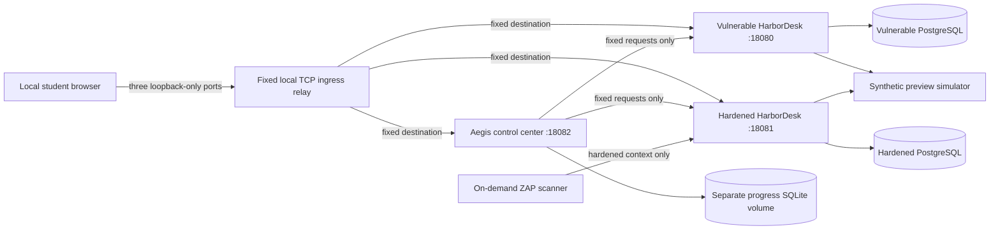
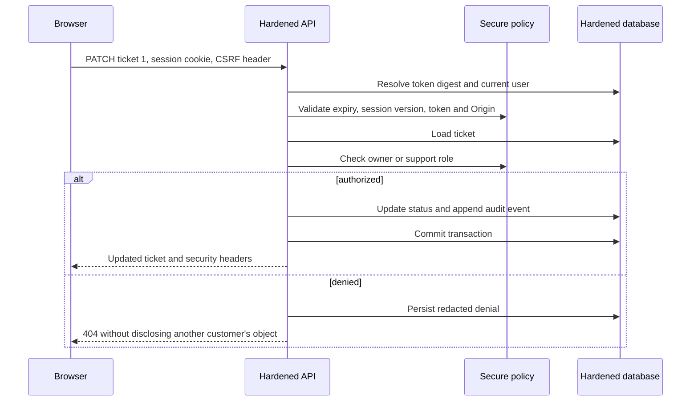

# Architecture

Aegis consists of a learning control center, two HarborDesk implementations, two independent PostgreSQL databases, and a synthetic preview service. FastAPI handles HTTP, SQLAlchemy models business data, Alembic owns schema evolution, and Jinja2 renders a modest progressively enhanced HTML interface. There is no frontend framework or external asset service.

## Module boundaries

| Location | Responsibility |
| --- | --- |
| `apps/core/models.py` | Users, tickets, comments, blobs, sessions, attempt buckets and audit events |
| `apps/core/routes.py` | Shared legitimate workflows and rendering routes |
| `apps/core/security.py` | Secure policy: ownership, roles, escaping, sessions, CSRF, search, uploads and previews |
| `apps/core/dependencies.py` | Authenticated principal, mutation checks and reusable authorization boundaries |
| `apps/vulnerable/policy.py` | Explicit intentional overrides, each labeled by laboratory |
| `apps/hardened/main.py` | Instantiates the secure policy without importing the training package |
| `apps/lab_control/` | Catalog, notebook, bounded HTTP evaluation and evidence/report export |
| `apps/simulator/` | Two fixed harmless internal document fixtures |
| `apps/ingress/` | Three fixed TCP listeners; no URL-selected destination or packet routing |
| `scripts/` | Host-only initialization, allowlisted lifecycle, isolation, locks, reports and plan validation |

The shared factory accepts a policy object from a distinct source entry point. No environment setting selects training behavior. Docker build targets copy the vulnerable package only into the vulnerable image; the hardened build excludes it. Keeping the policy difference small makes root causes reviewable without duplicating the business application.

## Data and transaction model

Each HarborDesk database is independent. Seeded rows use identical IDs and business content, but no live state is shared. Documents are inert database blobs; user filenames never become host paths. Public and private comments are filtered on the server. Sessions contain a SHA-256 digest of a random opaque token, CSRF token, expiry and user session version. The raw reference token exists only in the browser cookie and transient application memory.

Migration/seed initialization runs as the database owner in a one-shot service. Runtime uses a non-owner role with DML and sequence-use permissions, no role/database creation, no schema creation, and query/lock/idle-transaction timeouts. The intentional SQL demonstration runs in a separate read-only transaction and returns at most fifty rows. Initialization must succeed before the web service starts.

Shared request dependencies commit a successful unit of work and roll back on exceptions. Authentication failure accounting is committed intentionally before returning an error. The notebook uses short SQLite transactions and closes each connection; it is stored in its own volume and survives business resets.

## Request sequence

## UI and operational design

HarborDesk provides queue filtering, ticket detail, comments/private notes, uploads, status, assignment and profile forms. Static JavaScript uses `textContent` and DOM creation for untrusted API data. Only the two documented training HTML sinks bypass escaping. System fonts and local CSS/JS keep the UI offline and compatible with the hardened CSP.

The control center can send fixed educational requests and invoke an authenticated synthetic-data reset. It cannot access Docker or execute shell commands. Container lifecycle remains on the host behind a fixed project/service allowlist. The controller and simulator join the two application networks; they do not route packets or forward arbitrary destinations. This deliberate intermediary trust is discussed in the threat model.

See [network isolation](network-isolation.md), [threat model](threat-model.md) and [ADR 0001](architecture-decisions/0001-isolated-comparable-applications.md). Implementation presence does not prove Docker/runtime behavior; consult the verification record.
