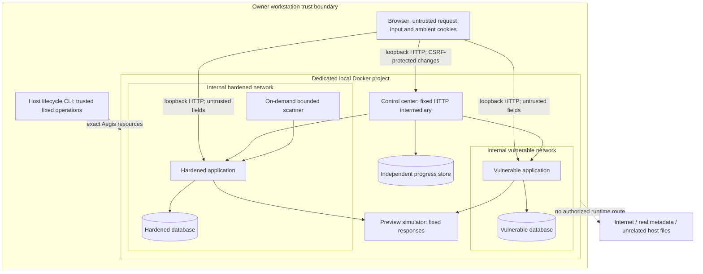

# HarborDesk threat model

Method: STRIDE applied to the implemented fictional support workflow. This model covers the hardened comparison target and Aegis containment; deliberate exceptions in the vulnerable image are educational demonstrations, not accepted production mitigations.

## Assets, people and assumptions

Assets are synthetic account credentials and roles; browser sessions; ticket content and ownership; private employee notes; attachment bytes; availability of the local lab; assessment evidence; and host filesystem/network isolation. Alice and Bob are separate customers. Sam is a support employee. Jordan (`admin`) administers assignments and roles. A fictional malicious customer seeks another customer's information or elevated operations; a malicious page attempts to reuse a signed-in browser's cookies. A curious student may mistype targets or change Compose bindings.

The owner controls the local workstation and Docker daemon. Host administrators and malicious local processes are outside the application trust boundary: loopback binding does not protect against them. Dependencies, Docker and the browser are trusted only to the extent established by current audits and pinned inputs. All data is fictional. There is no production SSO, email delivery, payment system, Internet preview fetching, or cloud metadata integration.

## Data flow and trust boundaries

The dotted edge represents a forbidden flow, not permitted connectivity. Network inspection must confirm that Docker has not introduced a route. Database credentials and owner operations are separate trust boundaries inside each network. No application container has the Docker socket or host directory access.

Sensitive entry points are login, all ticket mutations, private-note creation, document download/upload, assignment, role change, session logout, preview selection, synthetic reset and control-center evaluation. Data crosses browser-to-API, API-to-database, server-to-simulator, and control-to-application boundaries. Authorization must be checked at the destination business operation even when the UI hides a form.

## Authorization matrix (hardened)

| Operation | Customer | Support employee | Administrator | Anonymous |
| --- | --- | --- | --- | --- |
| List/read/update tickets | Own only | All | All | Denied |
| Create ticket | Own new request | Own new request | Own new request | Denied |
| Public comments | Own tickets | All | All | Denied |
| Read/create private notes | Denied | All | All | Denied |
| List/download/upload documents | Own tickets | All | All | Denied |
| Assign ticket | Denied | Denied | Allowed | Denied |
| Change own display name | Allowed | Allowed | Allowed | Denied |
| Change role / export audit | Denied | Denied | Allowed | Denied |
| Reset synthetic business data | Denied | Denied | Confirmed reset + CSRF | Denied |
| Preview public handbook | Allowed | Allowed | Allowed | Denied |
| Preview private metadata | Denied | Denied | Denied | Denied |

The local control center has no multi-user account boundary; the workstation owner is its intended user. State changes require a cookie-bound random token and the expected Origin. Review flags cannot assert verified test outcomes. Any untrusted local process can still access these services; that risk is accepted for a disposable training machine.

## Threat register

| ID / STRIDE | Concrete abuse case | Controls and related labs | Residual risk |
| --- | --- | --- | --- |
| T01 Information disclosure / tampering | Alice guesses Bob's ticket ID, including comments or update routes | Central object authorization, uniform 404; Labs 01/02 | Staff intentionally have broad support access |
| T02 Elevation of privilege | Customer calls a hidden assignment endpoint | Server-side admin dependency; Lab 03 | Admin fixture credentials are public local data |
| T03 Tampering / disclosure | Search changes the SQL ownership predicate | Bound ORM values; separate read-only training transaction; Lab 04 | Vulnerable SELECT still exposes synthetic data by design |
| T04 Spoofing / tampering | Saved or reflected text becomes active browser code | Final HTML encoding, safe DOM methods and CSP; Labs 05/06 | Existing XSS would undermine CSRF protections; no rich HTML feature |
| T05 Tampering | Another origin posts a profile form using ambient cookies | Synchronizer token, Origin check, SameSite strategy; Lab 07 | Loopback ports are same-site; SameSite alone is insufficient |
| T06 Spoofing / denial of service | Enumeration and repeated login attempts | Generic errors, dummy Argon2 check, persisted bounded buckets; Lab 08 | Throttling is one-worker protection and can temporarily block fixture logins |
| T07 Spoofing / elevation | Reuse a logged-out token or privilege snapshot | Backend invalidation, rotation, expiry, current session version; Lab 09 | A current bearer token remains valuable until invalidated |
| T08 Tampering / denial of service | Dangerous filename or excessive attachment content | Inert blob storage, generated keys, UTF-8/.txt checks, body/file limits; Lab 10 | No malware scanning or document-format parser; text only |
| T09 Information disclosure | Server intermediary accesses a private internal preview | Fixed destination selectors, exact public allowlist, no redirects/proxies, internal networks; Lab 11 | Controller/simulator join both lab networks and must remain non-routing fixed services |
| T10 Information disclosure | Debug response, CORS or malformed body reveals internals | Generic errors, validation-input redaction, restrictive headers; Lab 12 | Local HTTP lacks transport confidentiality |
| T11 Repudiation | A rejected action leaves no investigation record | Structured events, request IDs, audit export; all labs | Local DB logs are not tamper-evident or remotely archived |
| T12 Denial of service | Scan or reset affects other targets/resources | Named allowlists, time/resource bounds, source and effective checks | Docker/host administrators can bypass project scripts |
| T13 Supply-chain compromise | Unreviewed dependency/action changes alter training behavior | Hash locks, image digests, action SHAs, audit and review | Pins prevent drift, not malicious upstream packages or future advisories |

## Review procedure

When adding an endpoint, identify the actor and object, update the matrix, trace every alternate route to the policy check, and add a denial plus legitimate-use test. When changing networks, review intermediary connectivity, mounts and effective egress. When changing security controls, connect the threat to the lab and preserve paired evidence. Do not label T11/T13 as fully exercised OWASP categories merely because infrastructure controls exist.
